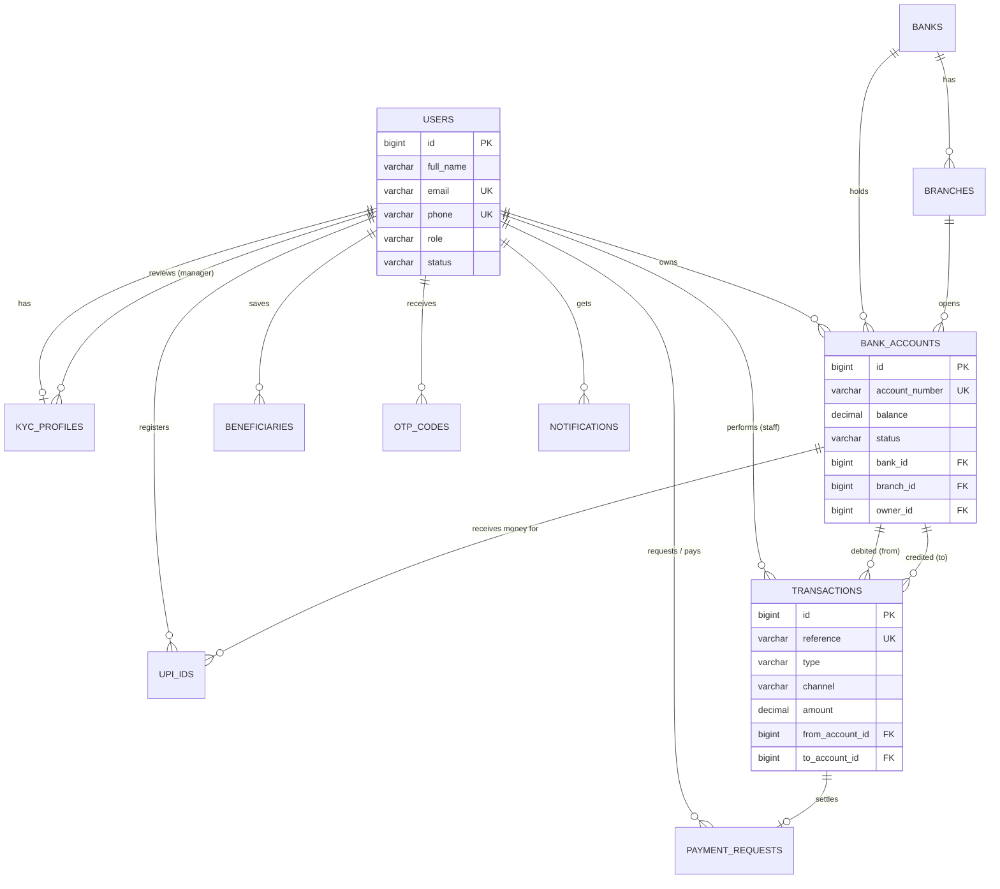

# Meridian — Database Design (Review-1 document)

**DBMS:** MySQL 8 (InnoDB) · **Tables:** 13 · **Views:** 5 · **Normal form:** 3NF · **Entities:** User, KYC, Bank, Branch, Bank Account, UPI ID, Transaction, Payment Request, Beneficiary, OTP, Outbox, Notification, Audit Log

## 1. ER diagram
Paste into https://mermaid.live (or view on GitHub / VS Code Mermaid preview) and export as PNG for your slides. The same diagram is drawn live, from the real database, in the app: **Database → ER diagram**.

## 2. Relationships (cardinality)
| Relationship | Cardinality | Implemented by |
|---|---|---|
| User — KYC profile | 1 : 1 | `kyc_profiles.user_id` UNIQUE |
| User — Bank account | 1 : N | `bank_accounts.owner_id` |
| Bank — Branch | 1 : N | `branches.bank_id` |
| Bank / Branch — Account | 1 : N | `bank_accounts.bank_id`, `branch_id` |
| User — UPI ID | 1 : N | `upi_ids.user_id` |
| UPI ID — Receiving account | N : 1 | `upi_ids.account_id` |
| Account — Transaction | 1 : N (twice: from / to) | `transactions.from_account_id`, `to_account_id` |
| Payment request — Transaction | 1 : 0..1 | `payment_requests.transaction_id` |
| User — Beneficiary / OTP / Notification | 1 : N | `owner_id` / `user_id` |

## 3. Data dictionary (tables and attributes)
**users** — `id` PK · `full_name` · `email` UK · `phone` UK · `password_hash` (BCrypt) · `role` (CUSTOMER/TELLER/MANAGER/AUDITOR/ADMIN) · `status` (PENDING_VERIFICATION/ACTIVE/DISABLED) · `failed_attempts` · `locked_until` · `last_login_at` · `created_at`

**kyc_profiles** — `id` PK · `user_id` FK UK · `date_of_birth` · `address` · `city` · `state` · `pincode` · `id_type` · `id_number_masked` (only last 4 chars) · `status` (NOT_SUBMITTED/PENDING/APPROVED/REJECTED) · `review_note` · `reviewed_by` FK→users · `submitted_at` · `reviewed_at`

**banks** — `id` PK · `code` UK (SBIN, HDFC…) · `name` · `short_name` · `color` · `headquarters` · `active`

**branches** — `id` PK · `bank_id` FK · `name` · `ifsc` UK · `city` · `state`

**bank_accounts** — `id` PK · `account_number` UK · `bank_id` FK · `branch_id` FK · `owner_id` FK · `type` (SAVINGS/CURRENT) · `balance` DECIMAL(15,2) CHECK ≥ 0 · `status` (ACTIVE/FROZEN/CLOSED) · `pin_hash` · `pin_attempts` · `pin_locked_until` · `primary_account` · `opened_at`

**upi_ids** — `id` PK · `vpa` UK (`name@meridian`) · `user_id` FK · `account_id` FK · `primary_vpa` · `created_at`

**transactions** (immutable ledger) — `id` PK · `reference` UK (12-digit UTR) · `type` (TRANSFER/CASH_DEPOSIT/CASH_WITHDRAWAL) · `channel` (UPI_ID/QR/BANK_ACCOUNT/REQUEST/COUNTER) · `status` · `amount` CHECK > 0 · `remark` · `from_account_id` FK · `to_account_id` FK · `from_vpa` · `to_vpa` · `from_balance_after` · `to_balance_after` · `performed_by` FK→users · `created_at`

**payment_requests** — `id` PK · `requester_id` FK · `payer_id` FK · `amount` · `note` · `status` (PENDING/PAID/DECLINED/CANCELLED) · `transaction_id` FK · `created_at` · `resolved_at`

**beneficiaries** — `id` PK · `owner_id` FK · `name` · `vpa` · `nickname` · UNIQUE(`owner_id`,`vpa`)

**otp_codes** — `id` PK · `user_id` FK · `purpose` (REGISTER/LOGIN/RESET_PASSWORD/RESET_PIN) · `code_hash` · `expires_at` · `attempts` · `consumed` · `created_at`

**message_outbox** (simulated SMS/e-mail gateway) — `id` PK · `channel` · `recipient` · `subject` · `body` · `created_at`

**notifications** — `id` PK · `user_id` FK · `title` · `message` · `type` · `seen` · `created_at`

**audit_logs** — `id` PK · `actor_id` · `actor_email` · `action` · `entity` · `entity_id` · `details` · `ip_address` · `success` · `created_at`

## 4. Views
`v_account_overview` · `v_transaction_statement` · `v_bank_summary` · `v_daily_volume` · `v_kyc_queue`

## 5. Design decisions worth mentioning to the examiner
* **3NF** — bank details live in `banks`/`branches`; accounts only reference them. Holder name is never duplicated; it is joined from `users`.
* **Integrity** — foreign keys everywhere, CHECK constraints (`balance ≥ 0`, `amount > 0`), UNIQUE on account number, UTR, IFSC, UPI ID.
* **Concurrency** — money transfers lock both account rows (`SELECT … FOR UPDATE`) in id order inside one ACID transaction, so no double-spend and no deadlock.
* **Ledger** — `transactions` is append-only and stores balance-after for both sides, so statements show a true running balance.
* **Security** — passwords, PINs and OTPs are stored only as BCrypt hashes; the explorer masks every `*hash*` column.
* **Audit** — application audit log plus a database trigger (`02_advanced_objects.sql`).
* **Many banks, one user** — a user can hold accounts in several banks; one UPI ID can be re-linked to any of them (the Google Pay / PhonePe model).
